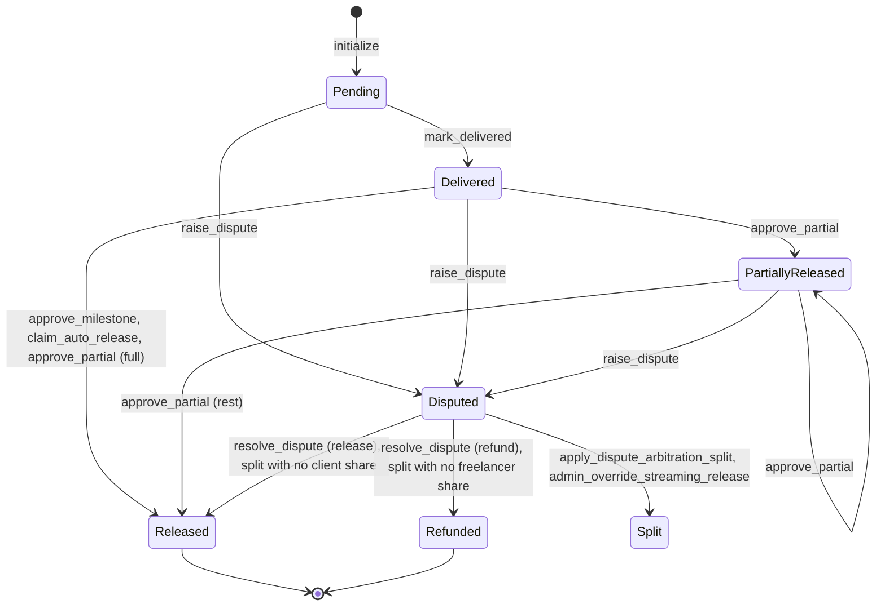
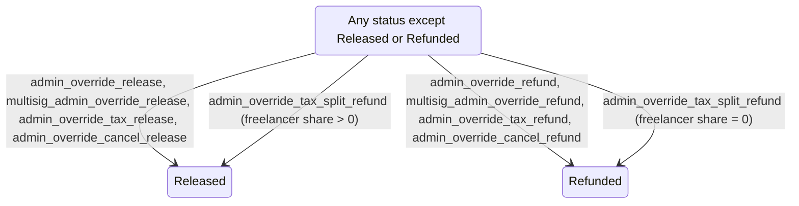
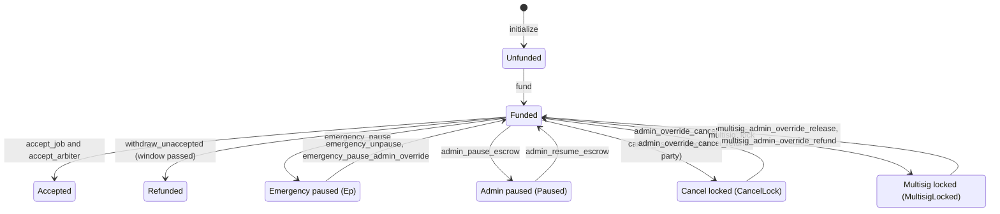

# Milestone Escrow: State Machine Specification

This document is the reference for every state transition in
`contracts/milestone-escrow/src/lib.rs`: which milestone and escrow-level states
exist, which entry point moves between them, who must sign, what tokens move and
which event is published.

PRs that add, remove or change a transition must update this file (see
`CONTRIBUTING.md`).

## Actors

| Actor | Set by | Notes |
|---|---|---|
| Admin | `initialize`, `transfer_admin`, `execute_admin_transfer` | Platform operator. Controls overrides, pauses, fees, yield, whitelist and upgrades. |
| Client | `initialize` | Funds the job and approves milestones. |
| Freelancer | `initialize` | Delivers milestones and receives payouts. |
| Arbiter | `initialize` | Resolves disputed milestones. |
| Multisig signer | `multisig_approval_init` | Approves proposal IDs (used by `execute_admin_transfer`). |
| Anyone | n/a | May call read-only and calculation endpoints, and `execute_admin_transfer` once it is approved. |

## Milestone states

`MilestoneStatus` has seven values:

| Status | Meaning |
|---|---|
| `Pending` | Created by `initialize`; not yet delivered. |
| `Delivered` | Freelancer marked it delivered; the auto-release window is running. |
| `PartiallyReleased` | Client released part of the amount with `approve_partial`. |
| `Disputed` | Frozen for arbitration. |
| `Released` | Fully paid to the freelancer. Terminal. |
| `Refunded` | Remaining amount returned to the client. Terminal. |
| `Split` | Remaining amount divided between client and freelancer by an arbitration or streaming split. |

### Normal workflow

### Admin override transitions

## Escrow-level states

These are independent flags stored in instance storage, not mutually exclusive
states.

| Flag | Key | Set by | Cleared by | Checked by |
|---|---|---|---|---|
| Funded | `JobMeta.funded`, `DataKey::FundedAt` | `fund` | never | most settlement entry points (`NotFunded`) |
| Acceptance | `DataKey::Acceptance` (bit 1 freelancer, bit 2 arbiter) | `accept_job`, `accept_arbiter` | never | `mark_delivered`, `raise_dispute`, `resolve_dispute`, `apply_dispute_arbitration_split` (`NotAccepted`), `withdraw_unaccepted` |
| Emergency pause | `DataKey::Ep` | `emergency_pause`, `emergency_pause_admin_override` | `emergency_unpause`, `emergency_pause_admin_override` | `ensure_not_paused` and the calculators listed below |
| Admin pause | `DataKey::Paused` | `admin_pause_escrow` | `admin_resume_escrow` | `assert_not_paused` |
| Cancel approval | `DataKey::CancelApproval` | `cancel_escrow` (first party) | `revoke_cancel_approval`, `cancel_escrow` (second party) | `cancel_escrow`, `revoke_cancel_approval` |
| Cancel lock | `DataKey::CancelLock` | `cancel_escrow` (second party) | `admin_override_cancel_release`, `admin_override_cancel_refund` | `ensure_not_paused` |
| Multisig lock | `DataKey::MultisigLocked` | `multisig_lock` | `multisig_admin_override_release`, `multisig_admin_override_refund` | the multisig override and split endpoints |
| Tax record | `DataKey::TaxWithholdingLock(i)` | `tax_withholding_deductions` | `admin_override_tax_release`, `admin_override_tax_refund`, `admin_override_tax_split_refund` | the tax override endpoints |
| Owed balance | `DataKey::Owed(address)`, `DataKey::TotalOwed` | any payout whose transfer fails | `withdraw` | `withdraw`, settlement balance caps |

`ensure_not_paused` rejects with `Paused` while `Ep` is set and with
`EscrowLocked` while `CancelLock` is set. `assert_not_paused` rejects with
`Paused` while the admin `Paused` flag is set.

## Payouts

Every payout from the contract to the client or freelancer goes through
`pay_or_credit`: the tokens are pushed to the recipient, and if that transfer
fails (for example a classic asset whose recipient has no trustline) the amount
is credited to `DataKey::Owed(recipient)` instead, so the settlement still
completes. The recipient claims credited amounts with `withdraw`. In the tables
below `→ freelancer` and `→ client` mean a payout made this way.

## State-changing entry points

Columns: required signer(s), guards checked before the transition, allowed
source milestone status, resulting status, token movement and published event
topic.

### Setup and funding

| Entry point | Signer(s) | Guards | Source status | Target status | Token movement | Event |
|---|---|---|---|---|---|---|
| `initialize` | admin | not initialized; valid addresses; non-empty positive amounts; `auto_release_seconds > 0` | none | every milestone `Pending` | none | `init` |
| `fund` | client | `ensure_not_paused`; not funded | n/a | job `funded = true` | client → contract, total amount | `fund` |
| `add_whitelisted_token` | admin | not funded; whitelist not full | n/a | n/a | none | `wtok` |
| `remove_whitelisted_token` | admin | not funded; token present; not the last token | n/a | n/a | none | `wldel` |
| `accept_job` | freelancer | not already accepted by the freelancer | n/a | sets freelancer acceptance | none | `acceptjob` |
| `accept_arbiter` | arbiter | not already accepted by the arbiter | n/a | sets arbiter acceptance | none | `acceptarb` |
| `withdraw_unaccepted` | client | `ensure_not_paused`; funded; not accepted by both; `ACCEPTANCE_WINDOW_SECONDS` (7 days) passed since funding | every milestone except `Released`, `Refunded` | `Refunded` | → client, sum of remaining | `unaccref` |

### Milestone workflow

| Entry point | Signer(s) | Guards | Source status | Target status | Token movement | Event |
|---|---|---|---|---|---|---|
| `mark_delivered` | freelancer | `ensure_not_paused`; funded; accepted by both | `Pending` | `Delivered` | none | `deliver` |
| `extend_milestone_deadline` | client | `assert_not_paused`; `extra_seconds > 0` | `Delivered`, `PartiallyReleased` | unchanged | none | `extend` |
| `approve_partial` | client | `ensure_not_paused`; funded; `0 < amount <= remaining` | `Delivered`, `PartiallyReleased` | `PartiallyReleased`, or `Released` when fully paid | → freelancer, `amount` | `approve` |
| `approve_milestone` | client | `ensure_not_paused`; funded | `Delivered` | `Released` | → freelancer, remaining | `approve` |
| `claim_auto_release` | freelancer | `ensure_not_paused`; auto-release deadline passed | `Delivered` | `Released` | → freelancer, remaining | `claim` |
| `withdraw` | recipient | owed balance > 0 | n/a | n/a | contract → caller, owed balance | `withdraw` |

### Disputes

| Entry point | Signer(s) | Guards | Source status | Target status | Token movement | Event |
|---|---|---|---|---|---|---|
| `raise_dispute` | client or freelancer | `ensure_not_paused`; funded; no dispute lock held; accepted by both | `Pending`, `Delivered`, `PartiallyReleased` | `Disputed` | none | `dispute` |
| `resolve_dispute` | arbiter | `ensure_not_paused`; funded; accepted by both | `Disputed` | `Released` (release) or `Refunded` (refund) | → freelancer or → client, remaining capped at available balance | `resolve` |
| `apply_dispute_arbitration_split` | arbiter | `ensure_not_paused`; funded; accepted by both | `Disputed` | `Refunded`, `Split` or `Released` depending on the shares | → client and → freelancer by `client_refund_bps`, capped at available balance | `resolve`, `arbsplit` |

### Cancellation

| Entry point | Signer(s) | Guards | Source status | Target status | Token movement | Event |
|---|---|---|---|---|---|---|
| `cancel_escrow` | client or freelancer | not emergency paused; not cancel locked; funded; positive balance; caller has not already approved | n/a | records approval; second party sets `CancelLock` | none | `cxlappr`, or `cancel` when locked |
| `revoke_cancel_approval` | client or freelancer | not cancel locked; caller has approved | n/a | clears caller's approval | none | `cancelrev` |
| `admin_override_cancel_release` | admin | `CancelLock` set; funded | every milestone except `Released`, `Refunded` | `Released`; clears `CancelLock`; resets `YieldAccrued` | → freelancer, sum of remaining | `adcovls` |
| `admin_override_cancel_refund` | admin | `CancelLock` set; funded | every milestone except `Released`, `Refunded` | `Refunded`; clears `CancelLock` and `YieldAccrued` | → client, sum of remaining | `adcovrf` |

### Admin overrides

| Entry point | Signer(s) | Guards | Source status | Target status | Token movement | Event |
|---|---|---|---|---|---|---|
| `admin_override_release` | admin | funded | any except `Released`, `Refunded` | `Released`; resets `YieldAccrued` | → freelancer, remaining | `admovrls` |
| `admin_override_refund` | admin | `assert_not_paused`; funded | any except `Released`, `Refunded` | `Refunded`; resets `YieldAccrued` | → client, remaining | `admovrf` |
| `admin_override_streaming_release` | admin | funded | `Disputed` | `Refunded`, `Split` or `Released` depending on the shares | → client and → freelancer by elapsed time, capped at available balance | `admstrm` |
| `multisig_admin_override_release` | admin | `MultisigLocked` set; funded | any except `Released`, `Refunded` | `Released`; clears `MultisigLocked` | → freelancer, remaining | `msadmrel` |
| `multisig_admin_override_refund` | admin | `MultisigLocked` set; funded | any except `Released`, `Refunded` | `Refunded`; clears `MultisigLocked` | → client, remaining | `msadmref` |
| `admin_override_tax_release` | admin | funded; tax record present | any except `Released`, `Refunded` | `Released`; removes tax record | → freelancer, net amount | `adtxrls` |
| `admin_override_tax_refund` | admin | funded; tax record present | any except `Released`, `Refunded` | `Refunded`; removes tax record | → client, gross amount | `adtxrfd` |
| `admin_override_tax_split_refund` | admin | funded; tax record present | any except `Released`, `Refunded` | `Released`, or `Refunded` when the freelancer share is zero; removes tax record | → client and → freelancer, net of tax | `adtwsplt` |
| `tax_withholding_deductions` | client and freelancer | funded; `tax_rate_bps <= 10_000` | `Pending`, `Delivered`, `PartiallyReleased` | unchanged; writes tax record | none | `taxwith` |

### Pauses and locks

| Entry point | Signer(s) | Guards | Effect | Token movement | Event |
|---|---|---|---|---|---|
| `emergency_pause` | client and freelancer | not already paused | sets `Ep` | none | `empause` |
| `emergency_unpause` | admin | paused | clears `Ep` | none | `emunpause` |
| `emergency_pause_admin_override` | admin | `paused` differs from current value | sets `Ep` to `paused` | none | `emoverrid` |
| `admin_pause_escrow` | admin | none (no-op when already paused) | sets `Paused` | none | `pause` |
| `admin_resume_escrow` | admin | paused | clears `Paused` | none | `resume` |
| `multisig_lock` | admin | not already locked | sets `MultisigLocked` | none | `mslock` |

### Admin, fees, yield and upgrades

| Entry point | Signer(s) | Guards | Effect | Event |
|---|---|---|---|---|
| `transfer_admin` | current admin | no pending admin transfer | replaces admin | `admin` |
| `propose_admin_transfer` | admin | no pending admin transfer | stores pending transfer | `adminprp` |
| `execute_admin_transfer` | anyone | pending transfer; its proposal reached the multisig threshold | replaces admin; clears pending transfer | `adminexc` |
| `cancel_admin_transfer_proposal` | admin | pending transfer | clears pending transfer | `admincxl` |
| `multisig_approval_init` | admin | not already initialised; valid signer set and threshold | stores signer set and threshold | `msiginit` |
| `multisig_approve` | registered signer | signer registered | sets the signer's bit for the proposal | `msigappr` |
| `set_platform_fee_allocation` | admin | allocation not locked; valid shares | stores allocation | `pf_set` |
| `lock_platform_fee_allocation` | admin | allocation initialised | locks allocation | `pf_lock` |
| `pf_alloc_admin_override` | admin | allocation locked; valid shares | stores allocation, unlocked | `pf_ovr` |
| `set_escrow_interest_yield` | admin | yield state not locked; shares sum to 10 000 | stores yield shares | `yldset` |
| `set_interest_yield_consent` | admin, client and freelancer | yield state not locked; shares sum to 10 000 | stores yield shares | `yldcons` |
| `lock_escrow_interest_yield` | admin | yield state unlocked | locks yield state | `yldlock` |
| `unlock_escrow_interest_yield` | admin | yield state locked | unlocks yield state | `yldunlock` |
| `admin_set_yield_rate` | admin | `assert_not_paused`; not emergency paused; `rate_bps <= 10_000` | stores yield rate | `yldrate` |
| `admin_accrue_yield` | admin | valid milestone; positive amount | adds to `YieldAccrued` | `yldacc` |
| `upgrade` | admin | `ensure_not_paused` | replaces contract code; bumps version | `upgrade` |

### Calculation endpoints

These return a computed split and publish an event, but move no tokens and
change no milestone or escrow state.

| Entry point | Signer(s) | Guards | Event |
|---|---|---|---|
| `split_refund_net_distribution` | none | not paused | `sprefnet` |
| `calculate_platform_fee_split` | none | allocation initialised | `pf_split` |
| `escrow_interest_yield` | none | valid inputs | `intyield` |
| `interest_yield_split_refund` | none | not paused; yield state unlocked | `iyspltref` |
| `tax_withholding_split_refund` | none | valid inputs | `twspltref` |
| `cancel_escrow_split_refund` | none | `ensure_not_paused`; `assert_not_paused` | `cxlspref` |
| `cancel_escrow_claim_refund` | admin | `CancelLock` set | `cxlspref` |
| `multisig_split_refund` | admin | `MultisigLocked` set | `splitref` |
| `multisig_transfer_admin` | admin | valid ratios | `msigtrx` |
| `admin_tax_withholding_deductions` | admin | funded | `taxwh` |
| `emergency_pause_split_refund` | client, freelancer or admin | emergency paused | `epspltref` |
| `emergency_pause_claim_refund` | admin | emergency paused | `emergency_pause_claim_refund` |
| `emergency_pause_allocation` | client, freelancer or admin | emergency paused | `epalloc` |
| `payment_streaming_milestones` | contract, client and freelancer | not paused | `p_stream` |
| `payment_streaming_consent` | client and freelancer | not paused | `p_strcns` |
| `milestone_time_extensions` | contract, client and freelancer | none | `m_ext` |
| `time_extensions_consent` | client and freelancer | not paused | `m_extcns` |

## Invariants

1. **Conservation.** For every milestone, the amount paid to the freelancer plus
   the amount refunded to the client must not exceed `amount`, and the contract
   must only pay out what it received in `fund`. Owed balances stay inside the
   contract and are excluded from the available balance used by settlement
   caps, so they are always backed.
2. **Terminal states are final.** No entry point accepts `Released` or
   `Refunded` as a source status.
3. **Delivery precedes approval.** `approve_milestone` and `claim_auto_release`
   require `Delivered`; `approve_partial` requires `Delivered` or
   `PartiallyReleased`.
4. **Parties consent before work starts.** Delivery and dispute endpoints
   require that both the freelancer (`accept_job`) and the arbiter
   (`accept_arbiter`) accepted the job; otherwise the client can reclaim the
   escrow with `withdraw_unaccepted` once the acceptance window has passed.
5. **Disputes are resolved only by the arbiter or the admin.** A `Disputed`
   milestone is moved only by `resolve_dispute`, `apply_dispute_arbitration_split`
   (arbiter) or the admin override endpoints.
6. **Who can move funds while paused.**
   - While emergency paused (`Ep`) or cancel locked, every endpoint guarded by
     `ensure_not_paused` is rejected: `fund`, `mark_delivered`,
     `approve_partial`, `approve_milestone`, `claim_auto_release`,
     `raise_dispute`, `resolve_dispute`, `apply_dispute_arbitration_split` and
     `upgrade`. The admin override endpoints do not check `Ep`, so only the
     admin can move funds.
   - While admin paused (`Paused`), `admin_override_refund` and
     `extend_milestone_deadline` are rejected.
   - `withdraw` is not gated by any pause, so owed balances can always be
     claimed.

## Read-only endpoints

These neither change state nor publish events: `get_job`, `get_reputation`,
`version`, `is_token_whitelisted`, `get_whitelisted_tokens`,
`time_until_auto_release`, `dispute_arbitration_split`, `is_emergency_paused`,
`get_platform_fee_allocation`, `is_multisig_approved`,
`get_pending_admin_transfer`, `is_escrow_interest_yield_locked`,
`get_escrow_interest_yield`, `get_yield_info`, `is_multisig_locked`.
